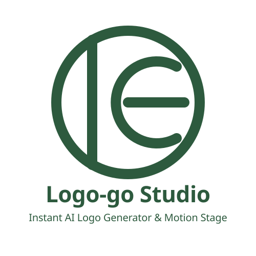
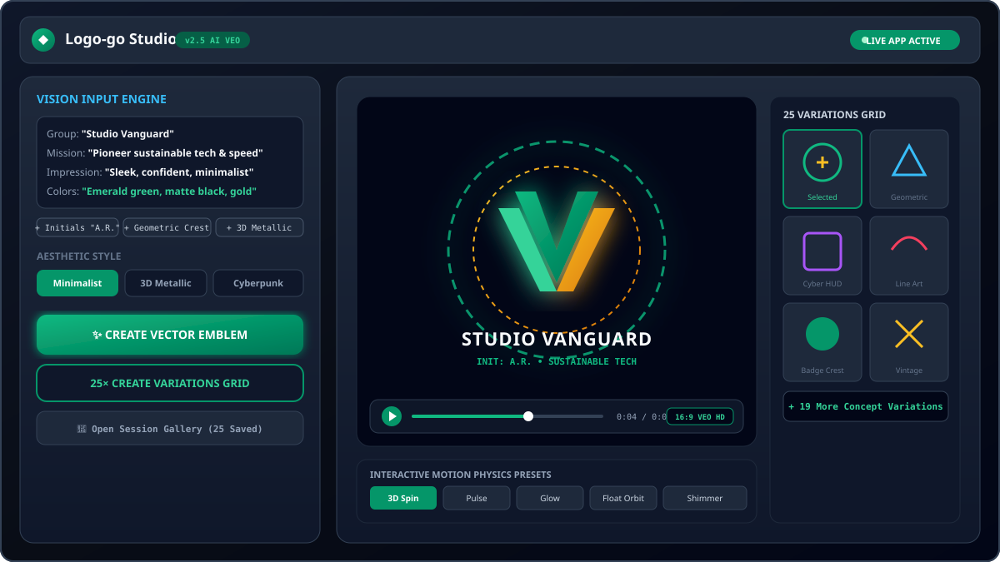

<p align="center">
  
</p>

# 🎨 Logo-go Studio — AI Vector Emblem & Motion Video Generator

[](https://ais-dev-lmno4gppu4ntjarny3pwjq-410398839749.us-west1.run.app)
[](https://react.dev)
[](https://www.typescriptlang.org/)
[](https://tailwindcss.com/)
[](https://ai.google.dev/)
[](https://deepmind.google/technologies/veo/)

> **Logo-go Studio** is an AI emblem, vector design, and high-definition motion video generation platform built with React, Vite, and Google Gemini AI. Transform structured brand vision prompts or reference images into professional vector logos, complete with color palette tuning, 6 interactive CSS motion physics presets, 16:9 HD video generation via Google Veo, a full-page expandable session gallery with enlarged cards, and a direct asset download & sharing suite.

---

## 🚀 Live Demo & Access

Experience the full live application directly in your browser using any of the live access URLs:

- 🟢 **[Open Live Application (Current Environment)](./)**
- ⚡ **[Development Server URL](https://ais-dev-lmno4gppu4ntjarny3pwjq-410398839749.us-west1.run.app)**
- 🌐 **[Shared Production URL](https://ais-pre-lmno4gppu4ntjarny3pwjq-410398839749.us-west1.run.app)**

---

## 🎬 Application Demo Showcase

<p align="center">
  
</p>

```text
+------------------------------------------------------------------------+
|  [>] Logo-go Studio Walkthrough — AI Emblem & Motion Video Suite     |
+------------------------------------------------------------------------+
|                                                                        |
|   +----------------------------------------------------------------+   |
|   |  1. THE VISION INPUT ENGINE                                    |   |
|   |  - Business/Organization/Group: "Studio Vanguard"              |   |
|   |  - Person / Initials: "A.R."                                   |   |
|   |  - Mission & Goals: "Pioneer sustainable tech & minimalism"    |   |
|   |  - Impression / Effect: "Sleek, confident, high-contrast"     |   |
|   |  - Color Choices: "Emerald green, matte black, gold accent"    |   |
|   |  - Reference Upload: Existing logos, UI screenshots or sketches |   |
|   +----------------------------------------------------------------+   |
|                               |                                        |
|                               v                                        |
|   +----------------------------------------------------------------+   |
|   |  2. 25 LOGO VARIATIONS CONTAINER                               |   |
|   |  - Ultra-minimalist line art    - 3D metallic glassmorphism    |   |
|   |  - Monoline crest emblem       - Vintage filigree badge        |   |
|   |  - Cybernetic neon HUD         - Organic ink brush sketch      |   |
|   +----------------------------------------------------------------+   |
|                               |                                        |
|                               v                                        |
|   +----------------------------------------------------------------+   |
|   |  3. MOTION STAGE & VEO VIDEO GENERATION                        |   |
|   |  - Interactive CSS Motion (3D Spin, Pulse, Glow, Float)        |   |
|   |  - 16:9 HD Motion Video powered by Google Veo (720p MP4)       |   |
|   +----------------------------------------------------------------+   |
|                               |                                        |
|                               v                                        |
|   +----------------------------------------------------------------+   |
|   |  4. SESSION CREATIONS GALLERY & ONE-CLICK SHARING              |   |
|   |  - IndexedDB multi-session history persistence                 |   |
|   |  - Full-page expandable gallery & filter tabs                  |   |
|   +----------------------------------------------------------------+   |
|                                                                        |
|  0:00 / 1:30  ========================o------------------- [HD] [fullscreen] |
+------------------------------------------------------------------------+
```

---

## ✨ Key Features Breakdown

### 1. ✍️ The Vision Input Engine
- **Structured Vision Parameters**: Specify Business/Organization/Group name, person (name or initials), mission statement/goals, impression/effect/characteristics, and preferred color choices.
- **Reference Image & Sketch Vectorizer**: Upload an existing logo, UI screenshot, inspiration image, or hand-drawn sketch (PNG, JPG, WebP, SVG) for AI vectorization and enhancement.
- **Quick-Add Vision Builders**: One-click prompt builder tags for fast parameter input (`+ Business/Organization/Group`, `+ Person / Initials`, `+ Mission / Goals`, `+ Impression / Effect`, `+ Color Choices`).
- **Smart Prompt Suggestions & Quota Resilience**: Real-time keyword and concept expansion powered by Gemini, backed by contextual offline fallbacks in case of network or rate-limit events.
- **Aesthetic Style Selector**: Choose from 6 specialized visual directions: *Minimalist, Modern, Abstract, Vintage, Cyberpunk,* and *Hand-drawn*.

### 2. 🗂️ 25 Logo Variations Container
- **Batch Variation Container**: Generates 25 distinct logo concept variations across diverse graphic sub-styles in a single container grid.
- **Instant Selection & Color Tuning**: Click any variation to inspect, apply custom color palettes, adjust dark/light mode backdrops, and test motion physics.

### 3. 🎬 Interactive Motion & Veo 2.0 Video Generator
- **6 Real-Time CSS Motion Presets**: Instantly preview 3D Spin, Gentle Pulse, Dynamic Glow, Floating Orbit, Hologram Flicker, and Shimmer Light Sweep animation physics directly on the web canvas.
- **Google Veo 2.0 & Canvas Motion Engine**: Renders high-definition 16:9 MP4 video animations of your emblem. Fully backed by local canvas video recording fallback to guarantee video creation on all devices.
- **Gallery Video Sync**: All generated videos automatically link to their respective emblems in the Session Creations Gallery for persistent playback and sharing.

### 4. 🎨 Session Creations Gallery, Full-Page View & Asset Export Suite
- **IndexedDB Persistent Storage**: Automatically saves all generated logos, color palettes, and motion videos across browser sessions.
- **Enlarged Card & List Gallery**: High-visibility thumbnail cards with crisp typography, color palette swatches, and active badges.
- **Full-Page Expandable Gallery Mode**: Toggle between side-drawer overlay and a full-page multi-column responsive grid view (`2-6 columns`).
- **Direct Asset Downloads**: Download logo images (SVG/PNG), Veo HD motion videos (MP4), structured design spec metadata (JSON), or batch-export the entire session gallery.
- **Gallery Filter Tabs**: Seamlessly switch between **All Creations**, **Logos Only**, and **Videos & Motion**.
- **Interactive Video Player Popup**: Watch video creations directly inside the gallery with full playback controls.
- **Multi-Platform Share Modal**: Share individual creations or the whole gallery via 1-click integrations for SMS, WhatsApp, Gmail, X/Twitter, Facebook, LinkedIn, Instagram, and TikTok.
- **Individual Deletion & Gallery Clear**: Delete specific creations individually or perform a complete gallery wipe with a single tap.

---

## 🛠️ Tech Stack & Architecture

- **Frontend Framework**: React 18, Vite 5, TypeScript
- **Styling**: Tailwind CSS, Framer Motion (`motion/react`)
- **Branding & Assets**: Custom SVG Brand Emblem (`/public/brand-logo.svg`), Demo Showcase SVG (`/public/demo-preview.svg`), Favicon (`/public/favicon.svg`)
- **AI Core**: Google Gemini 3.6 Flash SDK (`@google/genai`)
- **Video Generation**: Google Veo 3.1 Video Generation API (16:9 720p MP4)
- **Local Persistence**: IndexedDB (via custom promise-based wrapper)
- **Icons & Typography**: Lucide React, Space Grotesk / Plus Jakarta Sans

---

## 💻 Local Setup & Development

### Prerequisites
- Node.js 18.0 or higher
- npm 9.0 or higher
- A Google Gemini API Key ([Get an API key here](https://aistudio.google.com/))

### Installation Steps

1. **Clone the Repository**:
   ```bash
   git clone https://github.com/ashleyer/logo-go-studio.git
   cd logo-go-studio
   ```

2. **Install Dependencies**:
   ```bash
   npm install
   ```

3. **Configure Environment Variables**:
   Create a `.env` file in the project root:
   ```env
   GEMINI_API_KEY=your_google_gemini_api_key_here
   ```

4. **Start Development Server**:
   ```bash
   npm run dev
   ```
   Open your browser at `http://localhost:3000`.

5. **Build for Production**:
   ```bash
   npm run build
   ```

---

## 📂 Repository Structure

```text
logo-go-studio/
├── public/
│   ├── brand-logo.svg          # Official Logo-go Studio brand emblem SVG
│   ├── demo-preview.svg        # UI demo showcase vector illustration
│   └── favicon.svg             # Tab favicon matching brand emblem SVG
├── components/
│   ├── Header.tsx              # Top navigation bar with official brand emblem
│   ├── LogoGenerator.tsx       # Structured vision prompt, image uploader & style selector
│   ├── LogoDisplay.tsx         # Active emblem preview, SVG download & color tuner
│   ├── VariationsContainer.tsx # 25 Logo concept variations container grid
│   ├── VideoGenerator.tsx      # Motion preset selector & Veo video generator wrapper
│   ├── VideoResult.tsx         # Interactive CSS motion stage & Veo MP4 player
│   ├── HistorySidebar.tsx      # Full-page expandable gallery sidebar & video filter
│   ├── ShareModal.tsx          # Asset download suite & multi-platform share modal
│   └── Loader.tsx              # Animated loading spinners
├── services/
│   ├── geminiService.ts        # Gemini 3.6 Flash & Veo 3.1 Video API client logic
├── utils/
│   ├── db.ts                   # IndexedDB storage wrapper for logo history
│   └── videoRenderer.ts        # Canvas & MediaRecorder video rendering fallback
├── types.ts                    # TypeScript definitions for logo, video & palettes
├── App.tsx                     # Main layout & state orchestrator
├── server.ts                   # Full-stack Node/Express server entry point
├── README.md                   # Application documentation
└── package.json                # NPM package dependencies & scripts
```

---

## 🤝 Best Practices & Contribution Guidelines

We welcome contributions to Logo-go Studio! Please follow these guidelines:

1. **Fork & Branch**: Create a feature branch (`git checkout -b feature/amazing-feature`).
2. **Code Standards**:
   - Write clean, type-safe TypeScript code.
   - Use Tailwind CSS utility classes for styling.
   - Ensure all network calls handle errors gracefully with clear user feedback.
3. **Commit Messages**: Follow standard conventional commit format (`feat: add new logo style`, `fix: update indexeddb schema`).
4. **Pull Request Checklist**:
   - Verify local build passes: `npm run build`
   - Test responsive layout on mobile and desktop viewports.
   - Include a concise summary of changes in your PR description.

---

## ✉️ Developer Contact

built with 💚 in Boston by **[@ashleyer](https://github.com/ashleyer)**, 2026.

- **GitHub Profile**: [https://github.com/ashleyer](https://github.com/ashleyer)
- **Email**: [ashleye.romano@gmail.com](mailto:ashleye.romano@gmail.com)
- **Live Application**: [Development Server](https://ais-dev-lmno4gppu4ntjarny3pwjq-410398839749.us-west1.run.app) | [Shared URL](https://ais-pre-lmno4gppu4ntjarny3pwjq-410398839749.us-west1.run.app) | [Relative Path](./)

---

*© 2026 Logo-go Studio. Powered by Google Gemini AI & Veo Video Platform.*
